# ردیف ۹۴ — تجربهٔ نصب و آنبوردینگ: سند طراحی

> وضعیت: **سند طراحی** [S]. پیاده‌سازی این سند در این ردیف نیست. پیاده‌سازی پس از تصمیم مالک دربارهٔ **O‑21** انجام می‌شود. ردیف ۶۶ (Directory) و ردیف ۷۴ (هر ۵ موج کلاینت بومی) انجام شده‌اند.
> برچسب‌ها: **[S]** = بررسی‌شده در sandbox/CI روی کد مخزن · **[M]** = نیازمند دستگاه یا هاست واقعی (اجرا نشده).
> مرجع‌های کد: `apps/payesh/app/lib/src/login/session_controller.dart`، `apps/payesh/packages/payesh_sync/lib/src/school_access.dart`، `server/directory-api.js`، `server/school-access.js`، `server/transfer.js`، `server/gateway.js`.

## ۱. دامنه

این سند مسیر کاربر را از دریافت برنامه تا اولین صفحهٔ کاری طراحی می‌کند:

1. نصب (APK اندروید، EXE ویندوز)
2. کد مدرسه
3. کد فعال‌سازی و تعیین نقش
4. حالت اولیه بدون اینترنت
5. سه خطای اجباری معیار پذیرش: **کد اشتباه**، **قطع اینترنت**، **مدرسهٔ مهاجرت‌شده**

برای هر گام، رفتار فعلی کد (موج ۱ ردیف ۷۴) و رفتار طراحی‌شده کنار هم آمده‌اند. جایی که این دو فرق دارند، فاصله با شناسهٔ **G** ثبت شده است.

## ۲. نقش‌ها و منبع کد

| کاربر | کد مدرسه از کجا | کد فعال‌سازی از کجا |
|---|---|---|
| مدیر اولیه | پنل مالک هنگام ساخت مدرسه (ردیف ۱۲۱، یک بار نمایش) | همان پنل: کد یک‌بارمصرف مدیر (`provisionSchool`) |
| کادر، دبیر، ولی، دانش‌آموز | از مدیر مدرسه | مدیر برای هر کاربر صادر می‌کند: `POST /api/gw/v1/admin/activation-codes` (`issueActivation`، فقط مدیر، همان مدرسه) |

**تصمیم — انتخاب نقش:** برنامه هیچ صفحهٔ «انتخاب نقش» ندارد.
- نقش از ردیف `users` همان مدرسه خوانده می‌شود، هم هنگام فعال‌سازی و هم در هر تمدید (`readUser`).
- کد فعال‌سازی به یک کاربر مشخص بسته است. پس کاربر نمی‌تواند نقشی را انتخاب کند که مدرسه به او نداده است.
- کسی که دو نقش دارد (مثلاً دبیرِ ولی) دو حساب و دو کد دارد. روی یک دستگاه هر بار یک حساب فعال است، و تعویض حساب با «خروج» انجام می‌شود.
- بعد از فعال‌سازی، صفحهٔ تأیید **نقش را نشان می‌دهد** («شما با نقش ولی وارد شدید»، برچسب‌های `roleNameFa`). اگر نقش اشتباه باشد، کاربر قبل از شروع کار می‌فهمد و دکمهٔ «این من نیستم» او را خارج می‌کند.

## ۳. نمودار جریان

```mermaid
flowchart TD
  A[دریافت برنامه از صفحهٔ فرود ردیف ۱۱۴] --> B[نصب APK یا EXE]
  B --> C{اولین اجرا: مدرسهٔ ذخیره‌شده؟}
  C -- بله --> H[خانه فوراً باز می‌شود + تمدید در پس‌زمینه]
  C -- خیر --> D[گام ۱: کد مدرسه]
  D -->|شکل نادرست| D1[خطا روی دستگاه، چیزی ارسال نمی‌شود] --> D
  D -->|GET /api/dir/v1/resolve| E{پاسخ Directory}
  E -- 404 not_found --> D2[مدرسه‌ای با این کد پیدا نشد] --> D
  E -- 429 --> D3[شمارش معکوس، ارسال بسته] --> D
  E -- بدون اینترنت / 5xx --> O1[صفحهٔ بدون اینترنت: کد تایپ‌شده می‌ماند، تلاش دوباره] --> D
  E -- migrating یا moved --> M1[اطلاعیهٔ انتقال، ادامه با cell_url تازه] --> F
  E -- stable --> F[گام ۲: کد فعال‌سازی]
  F -->|POST /api/gw/v1/session/activate| G{پاسخ Gateway}
  G -- 401 activation_failed --> F1[کد پذیرفته نشد: اشتباه، استفاده‌شده یا منقضی] --> F
  G -- بدون اینترنت --> O2[کد تایپ‌شده می‌ماند، تلاش دوباره] --> F
  G -- ok --> R[تأیید نقش: «شما با نقش … وارد شدید»]
  R -- این من نیستم --> X[خروج] --> D
  R -- ادامه --> P[اولین دریافت داده: pull با نشان پیشرفت]
  P -- بدون اینترنت --> O3[خانه با نشان «هنوز داده‌ای دریافت نشده»؛ صفحه‌ها ادعای خالی بودن نمی‌کنند]
  P -- ok --> H
  H -->|تمدید یا push ناموفق| Q{دلیل}
  Q -- آفلاین --> H
  Q -- 401 refresh_failed / write_frozen / cell در دسترس نیست --> M2[دوباره‌پرسی Directory]
  M2 -- همان cell --> H
  M2 -- cell تازه --> M3[تمدید روی cell تازه]
  M3 -- ok --> H
  M3 -- 401 --> M4[مدرسه منتقل شده: کد فعال‌سازی تازه بگیرید؛ داده و صف روی دستگاه می‌ماند] --> F
```



نسخهٔ متنی برای نمایشگرهایی که mermaid را رسم نمی‌کنند:

```
نصب → [مدرسه ذخیره‌شده؟] ─بله→ خانه (تمدید در پس‌زمینه)
                         └خیر→ گام ۱ کد مدرسه → Directory ─→ گام ۲ کد فعال‌سازی → Gateway
                                   │404/429/آفلاین: همان صفحه     │401/آفلاین: همان صفحه
                                   └migrating/moved: اطلاعیه        └ok → تأیید نقش → اولین pull → خانه
خانه ─(401 / write_frozen / cell خاموش)→ دوباره‌پرسی Directory ─(cell تازه)→ تمدید روی cell تازه ─(401)→ کد تازه، داده می‌ماند
```

## ۴. گام‌ها

### ۴.۱ نصب

- **کانال‌ها:** صفحهٔ فرود مدرسه (ردیف ۱۱۴)، APK امضاشدهٔ اندروید (ردیف ۷۶) و نصب‌کنندهٔ ویندوز (ردیف ۷۷). به‌روزرسانی خودکار طبق ردیف ۷۸.
- **اولین اجرا:** اگر پرچم build کلاینت بومی را روشن نکرده باشد، کاربر به کلاینت وب هدایت می‌شود (`LegacyClient`). این رفتار فعلی است و تغییر نمی‌کند.
- **مجوزها:** برنامه در آنبوردینگ هیچ مجوزی (دوربین، مکان، مخاطبان) نمی‌خواهد. اعلان (push) در این نسخه نیست.

### ۴.۲ گام ۱ — کد مدرسه

- **ورودی:** حروف کوچک لاتین، رقم و خط تیره. رقم فارسی به لاتین تبدیل می‌شود. الگو روی دستگاه همان `SLUG_RE` سرور است، پس کد با شکل نادرست اصلاً ارسال نمی‌شود.
- **فراخوانی:** `GET /api/dir/v1/resolve?school_code=`. پاسخ `cell_url`، `migration_state` و `ttl` را می‌دهد. cell فقط با https پذیرفته می‌شود.
- **حفظ حریم:** Directory برای کد ناموجود و کد بدشکل **یک پاسخ یکسان** (`404 not_found`) می‌دهد، تا نتوان کد مدرسه‌ها را حدس زد. پیام کاربر هم یکی است.
- **طراحی تازه:** دکمهٔ «کد را از کجا بگیرم؟» یک راهنمای کوتاه باز می‌کند: «کد مدرسه را مدیر مدرسه می‌دهد؛ معمولاً روی برگهٔ ثبت‌نام یا در گروه مدرسه است.»

### ۴.۳ گام ۲ — کد فعال‌سازی

- **ورودی:** ۳۲ نویسه از A تا Z و رقم‌های ۲ تا ۷. فاصله و خط تیره حذف و حروف بزرگ می‌شوند، مثل `normCode` سرور.
- **فراخوانی:** `POST /api/gw/v1/session/activate` با `school`، `code` و `device_id`. پاسخ توکن مدرسه و `device_secret` را یک بار می‌دهد.
- **یک پاسخ برای همهٔ خطاها:** مدرسهٔ اشتباه، کد اشتباه، کد استفاده‌شده و کد منقضی همه `401 activation_failed` می‌گیرند، تا پاسخ نگوید کدام بخش درست بوده است.
- **ذخیره:** فقط کد مدرسه، `cell_url`، `device_secret` و آخرین نقش در SecureStore سکو ذخیره می‌شوند. توکن فقط در حافظه می‌ماند.

### ۴.۴ تأیید نقش و اولین دریافت داده (طراحی تازه)

- **صفحهٔ تأیید:** پس از فعال‌سازی، نام مدرسه، نقش (`roleNameFa`) و دو دکمه («ادامه» و «این من نیستم») نمایش داده می‌شوند.
- **اولین pull** با نشان پیشرفت اجرا می‌شود.
- **G6 — پیش از اولین دریافت داده:** صفحه‌ها نباید بگویند «فرزندی متصل نیست» یا «اطلاعیه‌ای نیست».
  - حالت درست: «هنوز داده‌ای از مدرسه دریافت نشده — پس از اتصال خودکار دریافت می‌شود.»
  - امروز صفحه‌ها پایگاه خالی محلی را «خالی» نشان می‌دهند. در طراحی، تا اولین pull موفق یک پرچم `firstSyncDone` در meta پایگاه محلی صفحه‌ها را در حالت «در انتظار اولین دریافت» نگه می‌دارد.

## ۵. حالت اولیه بدون اینترنت

| لحظه | رفتار فعلی [S] | رفتار طراحی‌شده |
|---|---|---|
| گام ۱ بدون اینترنت | پیام «اتصال اینترنت برقرار نیست — اتصال را بررسی کنید» و کد تایپ‌شده می‌ماند | همان، به‌اضافهٔ دکمهٔ «تلاش دوباره» و تلاش خودکار وقتی شبکه برگشت |
| گام ۲ بدون اینترنت | همان پیام. کد فعال‌سازی یک‌بارمصرف **مصرف نمی‌شود**، چون به سرور نرسیده | همان. پیام اضافه: «کد شما هنوز معتبر است» |
| پس از فعال‌سازی و پیش از اولین pull | خانه باز است و نشان Sync «آفلاین» را نشان می‌دهد | به‌اضافهٔ G6: صفحه‌ها در حالت «در انتظار اولین دریافت» |
| اجرای بعدی بدون اینترنت | خانه فوراً باز می‌شود. نوشتن‌ها در صف ماندگار می‌مانند و نشان Sync تعداد در صف را نشان می‌دهد | بدون تغییر |
| فعال‌سازی کاملاً آفلاین | ممکن نیست: فعال‌سازی به Directory و Gateway نیاز دارد | ممکن نیست (تصمیم). کد فعال‌سازی باید روی سرور مصرف شود تا دو دستگاه یک کد را به کار نبرند. کلاینت وب مدرسه (شبکهٔ محلی) گزینهٔ جایگزین می‌ماند |

## ۶. موارد خطا

### ۶.۱ کد اشتباه

| مورد | تشخیص | پیام | رفتار |
|---|---|---|---|
| کد مدرسهٔ بدشکل | روی دستگاه | «کد مدرسه درست نیست — فقط حروف انگلیسی کوچک، رقم و خط تیره (۳ تا ۴۰ نویسه)» | چیزی ارسال نمی‌شود |
| کد مدرسهٔ ناموجود | `404 not_found` | «مدرسه‌ای با این کد پیدا نشد — کد را از مدیر مدرسه بپرسید» | همان صفحه، کد تایپ‌شده می‌ماند |
| کد فعال‌سازی بدشکل | روی دستگاه | «کد فعال‌سازی ۳۲ نویسه است (حروف A تا Z و رقم‌های ۲ تا ۷) — دوباره بنویسید» | چیزی ارسال نمی‌شود |
| کد فعال‌سازی اشتباه، استفاده‌شده یا منقضی | `401 activation_failed` | «کد فعال‌سازی پذیرفته نشد — ممکن است اشتباه، استفاده‌شده یا منقضی باشد» | همان صفحه. دکمهٔ «تغییر مدرسه» |
| تلاش زیاد | `429` با `retry_after_ms` | «تلاش‌ها زیاد بود — N ثانیهٔ دیگر دوباره امتحان کنید» | تا پایان زمان هیچ درخواستی فرستاده نمی‌شود |
| نسخهٔ قدیمی برنامه | `426` / `api_version_unsupported` | «این نسخهٔ برنامه دیگر پشتیبانی نمی‌شود — برنامه را به‌روز کنید» | پیوند به‌روزرسانی (ردیف ۷۸) |

### ۶.۲ قطع اینترنت

| مورد | پیام | رفتار |
|---|---|---|
| بدون اتصال یا timeout | «اتصال اینترنت برقرار نیست — اتصال را بررسی کنید» | ورودی می‌ماند. پس از فعال‌سازی، کاربر وارد می‌ماند |
| سرور در دسترس نیست (5xx/503) | «سرور مدرسه موقتاً در دسترس نیست — کمی بعد دوباره امتحان کنید» | همان |
| TLS یا pin رد شد | «اتصال امن به سرور تأیید نشد — چیزی ارسال نشد؛ شبکه را عوض کنید یا به پشتیبانی خبر دهید» | هیچ بایتی ارسال نمی‌شود (ردیف ۷۵) |
| cell غیر https | «نشانی سرور مدرسه امن (https) نیست — اتصال برقرار نشد؛ به پشتیبانی خبر دهید» | ادامه نمی‌دهد |

### ۶.۳ مدرسهٔ مهاجرت‌شده

Directory برای هر مدرسه یکی از این سه وضعیت را برمی‌گرداند: `stable`، `migrating` یا `moved` (`server/directory.js`). مدت اعتبار پاسخ برای `migrating` کوتاه است (۱۵ ثانیه) و برای `moved` هم کوتاه (۳۰ ثانیه)، و برای `stable` پنج دقیقه.

| مورد | رفتار فعلی [S] | رفتار طراحی‌شده |
|---|---|---|
| ورود تازه در حال انتقال (`migrating`) | در گام ۲ اطلاعیه نمایش داده می‌شود: «این مدرسه در حال انتقال به سرور تازه است — ورود ممکن است کمی طول بکشد» | همان |
| ورود تازه پس از انتقال (`moved`) | Directory نشانی cell تازه را می‌دهد و ورود عادی است | همان |
| دستگاه فعال در طول انتقال | push پاسخ `409 write_frozen` می‌گیرد. صف این را گذرا می‌داند و نگه می‌دارد (`isTransient`)، پس دادهٔ تازه از دست نمی‌رود | همان، به‌اضافهٔ پیام «مدرسه در حال انتقال است — ثبت‌ها نگه داشته می‌شوند» |
| دستگاه فعال پس از انتقال | **G1:** `cell_url` ذخیره‌شده هرگز دوباره از Directory پرسیده نمی‌شود. دستگاه به cell قدیمی وصل می‌ماند | دوباره‌پرسی Directory در چهار حالت: انقضای `ttl` در شروع برنامه، `write_frozen`، `401 refresh_failed`، و ناکامی پیاپی اتصال به cell وقتی Directory در دسترس است |
| cell تازه، اعتبار دستگاه | **G2:** ابزار انتقال (`server/transfer.js`) فقط جدول‌های `product_*` و `gateway_quota` را منتقل می‌کند، نه `gw_credential` و `gw_school`. پس `device_secret` روی cell تازه معتبر نیست | دو راه، با تصمیم مالک: (الف) ابزار انتقال جدول‌های اعتبار را هم منتقل کند، یا (ب) پس از انتقال، کاربر کد فعال‌سازی تازه بگیرد. پیش‌فرض طراحی (ب) است، چون راز جابه‌جا نمی‌شود |
| 401 روی cell قدیمی | **G5:** امروز `refresh_failed` بی‌درنگ راز دستگاه را پاک می‌کند و کاربر را به گام ۱ می‌برد | اول Directory دوباره پرسیده می‌شود. اگر cell عوض شده باشد، پیام «مدرسه به سرور تازه منتقل شده — کد فعال‌سازی تازه را از دفتر مدرسه بگیرید» نمایش داده می‌شود و کاربر مستقیم به گام ۲ همان مدرسه می‌رود |
| داده و صف روی دستگاه | ادعای مالکیت دستگاه (`DeviceOwner`) با مدرسه و uid یکسان صف را نگه می‌دارد | پس از فعال‌سازی دوباره با همان کاربر، صف از همان‌جا ادامه می‌یابد. اگر کاربر دیگری وارد شود، نوشتن‌های ارسال‌نشده مثل امروز جلوی همگام‌سازی را می‌گیرند و هرگز بی‌صدا پاک نمی‌شوند |

## ۷. فاصله‌های کشف‌شده (برای پیاده‌سازی)

| شناسه | فاصله | محل | پیشنهاد |
|---|---|---|---|
| G1 | `cell_url` ذخیره‌شده پس از فعال‌سازی هرگز دوباره پرسیده نمی‌شود | `session_controller.dart` (`refresh` فقط `saved.cellUrl` را صدا می‌زند) | دوباره‌پرسی با `ttl` و چهار محرک §۶.۳ |
| G2 | انتقال مدرسه اعتبار دستگاه را منتقل نمی‌کند | `server/transfer.js` (`ALLOWED_TABLES`) | تصمیم مالک: انتقال اعتبار یا فعال‌سازی دوباره (پیش‌فرض) |
| G3 | پیام ویژه برای `write_frozen` نیست؛ فقط نشان Sync «در صف» دیده می‌شود | `outbox.dart` (`isTransient`) | پیام انتقال روی نشان Sync |
| G4 | صفحه‌ای برای صدور کد فعال‌سازی کاربران نیست. نقطهٔ پایانی هست، ولی نه در کلاینت وب و نه در کلاینت بومی | `server/gateway.js` (`/api/gw/v1/admin/activation-codes`) | صفحهٔ مدیر: «صدور کد ورود» کنار هر کاربر، نمایش یک‌باره و QR |
| G5 | `refresh_failed` بدون دوباره‌پرسی Directory راز را پاک می‌کند | `session_controller.dart` (`deviceRevoked`) | اول دوباره‌پرسی، سپس تصمیم |
| G6 | صفحه‌ها پیش از اولین pull «خالی» را نشان می‌دهند | صفحه‌های موج ۲ تا ۵ | پرچم `firstSyncDone` و حالت «در انتظار اولین دریافت» |

`tests/onboarding-94.js` فاصله‌های G1، G2، G4 و G5 را با کد مخزن مقایسه می‌کند. وقتی یکی از آن‌ها رفع شود، آزمون قرمز می‌شود تا این سند به‌روز شود.

## ۸. وابستگی به O‑21

O‑21 در قانون اساسی (`docs/00-PAYESH-CLOUD-CONSTITUTION.md`) این است: «آیا مسیردهی cell (دایرکتوری ۴۳) جایگزین D‑07 شود یا فقط مسیر خروج بماند؟»

| تصمیم O‑21 | اثر بر آنبوردینگ |
|---|---|
| Directory مسیر اصلی می‌شود | همین سند بی‌تغییر. گام ۱ همیشه از Directory می‌گذرد و G1/G5 لازم‌اند |
| Directory فقط مسیر خروج می‌ماند | گام ۱ با cell ثابت build کار می‌کند (`fallbackCell`، آزمون W1-IT-06). وقتی Directory پیکربندی نشده باشد، گام ۱ فقط کد مدرسه را برای همان cell می‌سنجد. انتقال مدرسه بدون Directory به build تازه یا تنظیم دستی نیاز دارد، و G1 به «تغییر سرور» دستی در تنظیمات تبدیل می‌شود |

## ۹. معیار پذیرش پیاده‌سازی (برای ردیف بعدی)

- آزمون ویجت برای هر سطر جدول‌های §۶، از جمله کنترل منفی: کد مصرف‌نشده پس از قطع اینترنت هنوز معتبر است، کد استفاده‌شده رد می‌شود، و 401 روی cell قدیمی پیش از دوباره‌پرسی چیزی پاک نمی‌کند.
- IT واقعی: انتقال مدرسه با `tools/cell-transfer-54.mjs` بین دو پایگاه، سپس دستگاه فعال ⇒ دوباره‌پرسی ⇒ cell تازه ⇒ فعال‌سازی دوباره ⇒ صف ارسال‌نشده روی cell تازه اعمال می‌شود، بدون تکرار.
- صفحهٔ تأیید نقش و «این من نیستم».
- حالت «در انتظار اولین دریافت» (G6).
- صفحهٔ صدور کد مدیر (G4).

## ۱۰. اجرا نشده — NOT RUN [M]

- آزمون آنبوردینگ با کاربر واقعی (مدیر، ولی) و زمان‌سنجی هر گام.
- نصب روی گوشی Android یا رایانهٔ Windows واقعی.
- انتقال واقعی مدرسه بین دو هاست (ردیف ۵۴: باز کردن ابزار انتقال تصمیم مالک است؛ ردیف ۱۲۰ Blocked).
- صفحه‌خوان واقعی روی صفحه‌های آنبوردینگ.
- امنیت کل سامانه تا ردیف ۹۲ (پنتست انسانی) **UNKNOWN** است.
